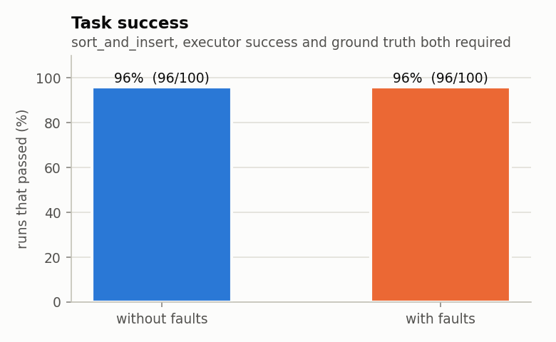
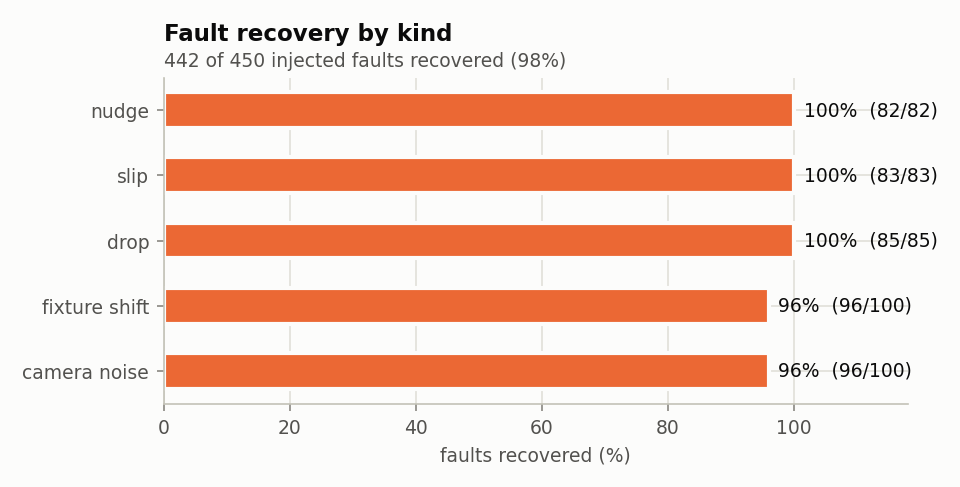
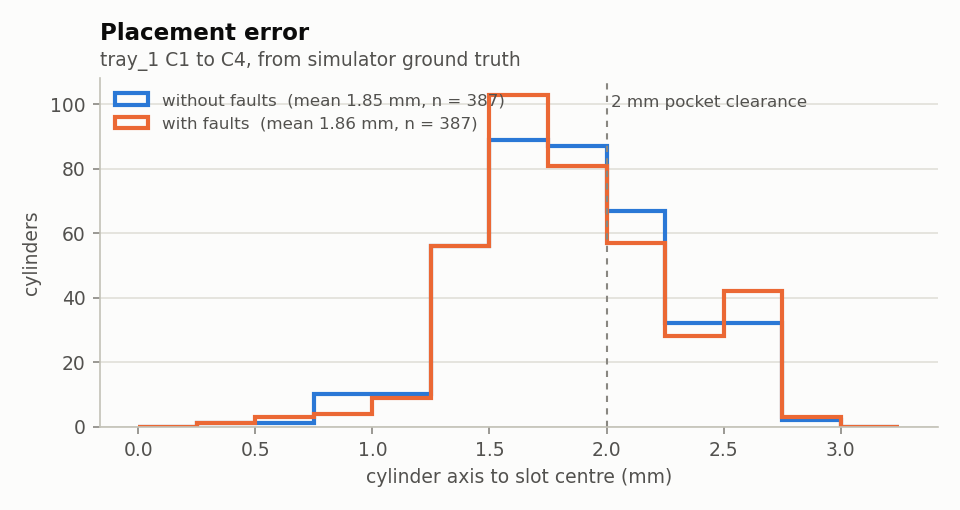
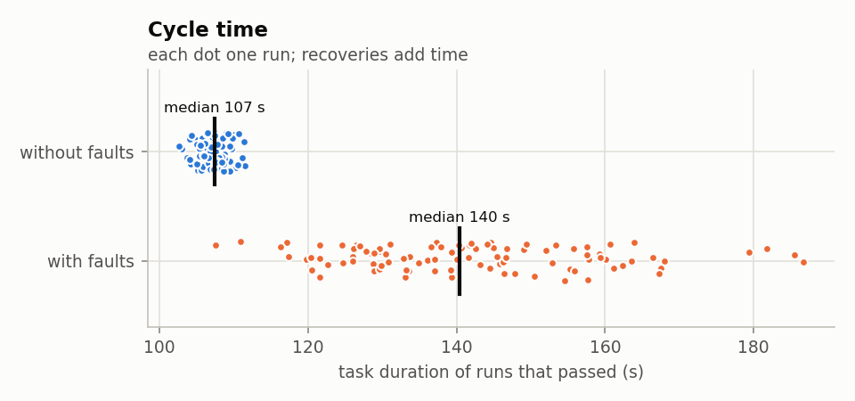

# Reliability

| | Without faults | With faults |
|---|---|---|
| Runs | 100 | 100 |
| Task success | 96% | 96% |
| Faults injected | 0 | 450 |
| Faults recovered | n/a | 98% |
| Skill failures recovered | 0/3 | 250/252 |
| Slot placement error (mean) | 1.85 mm | 1.86 mm |
| Peg error (mean) | 0.38 mm | 0.83 mm |
| Task duration (mean, passed runs) | 107 s | 142 s |

Faults: nudge, slip, drop, fixture_shift, camera_noise at rate 0.15 per opportunity, at most one per object a run. By kind: camera_noise 96/100, drop 85/85, fixture_shift 96/100, nudge 82/82, slip 83/83.

