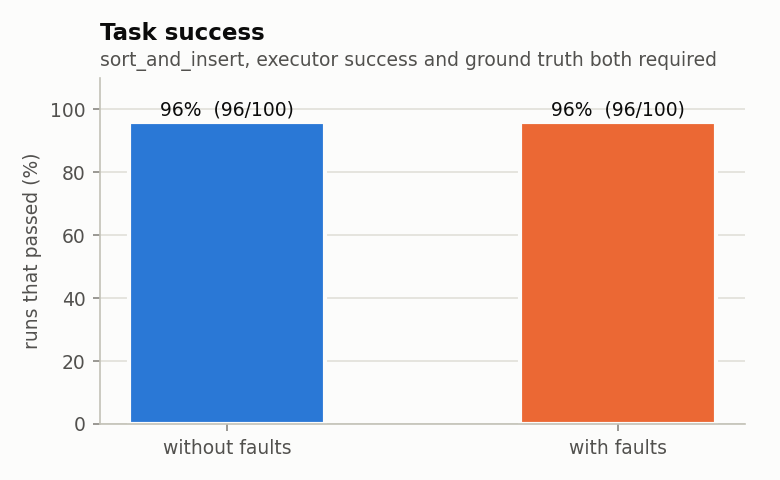
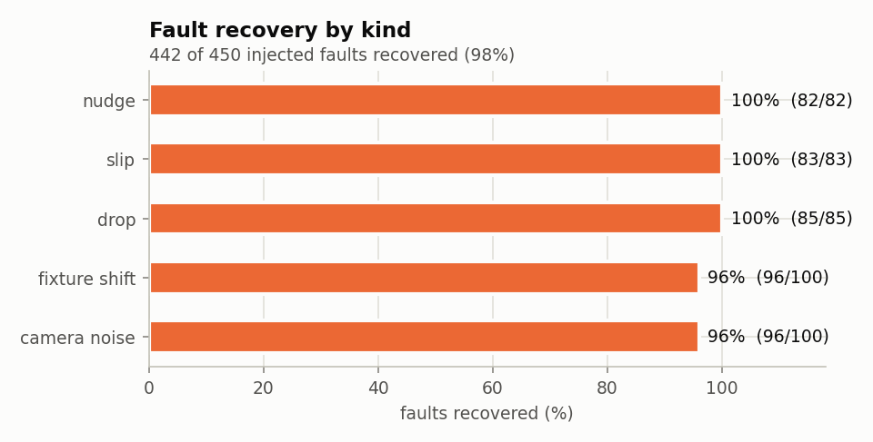

# cell_executor

This is the task executor, the part of the cell that runs whole jobs rather than single skills.
A task is a YAML list of steps. The executor turns it into a
[BehaviorTree.CPP v4](https://www.behaviortree.dev/) tree whose leaves call the `cell_skills`
action servers, and ticks that tree until the task succeeds, fails or is aborted. A running task
can be paused, resumed or aborted from outside, every run leaves a log behind, and the running
tree can be watched live in Groot2. Run a task with:

```bash
# run a task at startup
ros2 launch cell_bringup cell.launch.py task:=sort_and_insert

# or send one to a running cell
ros2 action send_goal --feedback /executor/execute_task cell_interfaces/action/ExecuteTask \
  "{task_file: sort_and_insert}"

ros2 service call /executor/pause  std_srvs/srv/Trigger   # finish the running skill, then hold
ros2 service call /executor/resume std_srvs/srv/Trigger
ros2 service call /executor/abort  std_srvs/srv/Trigger   # cancel the running skill and stop
ros2 topic echo /executor/state                            # JSON: step, object, skill, phase
ros2 run cell_executor tree_status.py                      # running branch of the live tree
```

## Task files

This is the reference task, `tasks/sort_and_insert.yaml`:

```yaml
name: sort_and_insert
on_failure: safe_stop          # or: skip_step, abort
steps:
  - detect: {}
  - for_each:
      filter: {color: red}
      do:
        - pick: {object: $item}
        - place: {target: bin_a}
  - for_each:
      filter: {class: cylinder}
      max: 4
      do:
        - pick: {object: $item}
        - place: {target: tray_1/C$index}   # C1..C4
  - pick: {object: peg_0}
  - insert: {target: peg_fixture, max_attempts: 3}
  - move_to: {pose: home}
```

The cylinder loop filters on `class: cylinder` rather than on the shape, because the peg's shape
is a cylinder too.

| Step | Arguments | Skill |
|---|---|---|
| `detect` | `class`, `color` (optional filters), `frames` (average several, 1 to 30) | `DetectObjects` |
| `pick` | `object` (required), `grasp` | `Pick` |
| `place` | `target` (required), `compliance: true/false` | `Place` |
| `insert` | `target` (required), `max_force` (N), `max_attempts` | `Insert` |
| `move_to` | `pose` (required, SRDF named pose) | `MoveToNamedPose` |
| `dispense` | none | `/lab/dispense` (lab scene) |
| `wait` | `seconds` (required) | none |
| `for_each` | `do` (required, list of steps), `filter`, `max` | none |
| `watch` | `when` and `do` (required), `filter`, `period`, `timeout` | none |
| `if` | `then` (required), one or more of `color`, `hue`, `area`, and `else`, `item` | none |
| `repeat_until` | `color` and `do` (required), `max` (default 10), `on_max`, `item` | none |

A step with one main argument can be written as a scalar, so `- move_to: home`,
`- place: bin_a` and `- detect` are all valid.

Objects come from the detections. A step refers to one by its id (`blue_cylinder_2`) or by
`<class>_<n>` or `<type>_<n>`, the n-th object of that class or type ordered by id, so `peg_0`
is the first detected peg. An object keeps the id it was first detected with for the whole run,
even when it looks different later: each detection is matched to the known object of the same
class within 2 cm of where it was last seen, and a place moves the object to its target. That is
what lets a task wait for a vial to change colour, since the detector names things by what they
look like now (a vial that turned green is `vial_green_0` to the detector, but stays
`vial_blue_1` to the task).

`for_each` runs its `do` steps once per detected object that matches `filter` (the fields are
`class`, `color` and `type`), at most `max` times, skipping objects that have been put away. An
object counts as put away from the moment it is placed until it is picked again, so a vial picked
back out of the dispenser is in play again. The objects are chosen when the loop starts, and when
that list runs out the loop asks again, so an object a look inside the loop saw for the first time
is handled too (a one-frame look at the start of a readout run once missed a tube that the six-frame
look inside the loop found). Inside the loop `$item` is the object id and `$index` its 1-based
number, and they work in any argument, as in `tray_1/C$index`. `for_each` and `watch` both set
`$item`, so neither can sit inside the other.

`watch` is for things that happen on their own time. It looks (a detection) and takes every
object that matches `filter` as watched; then each time it looks it handles every watched
object that meets `when`, one at a time and looking again after each, because more may have
changed meanwhile. When nothing is ready it waits `period` seconds (default 3) and looks again.
It ends when every watched object has been handled, and fails after `timeout` seconds (default
300). `when` takes a value or a list, `{color: [green, brown]}`.

`if` tests what an object looks like now, `$item` unless `item` says otherwise, and runs `then` or
`else` (which may be left out). Besides `color` it can test two measurements perception reports:
`hue`, the top face's mean hue in degrees, and `area`, the colony inside a culture dish in mm^2.
Those take comparisons, and every one in a list must hold, so `hue: ["<=125", ">=95"]` is a range;
`watch`'s `when` takes them too, as in `when: {area: ">=550"}`. `repeat_until` checks its object
before every round and runs `do` until the object meets the condition, so its steps have to change
the object and look at it again, as the titration's `dispense`, `wait`, `detect` does. After `max`
rounds it fails, or with `on_max: continue` carries on so the task can deal with the object itself.

Trays named on their own get their next free slot in row order, so `place: rack_done` fills
`rack_done/A1`, then `A2`, and so on, and a tray with a row letter fills that row, so `place:
rack_done/B` gives `rack_done/B1`, then `B2`; a tray with a single slot, such as the lab's
dispenser, is simply its own slot. Bins have drop spots. `workspace.yaml` gives a bin a `spots:
[rows, cols]` grid, and `place: bin_a` puts each object on the next free spot (`bin_a/1`, `bin_a/2`,
...). The spots are there because two cubes placed at the bin centre landed on each other; with them
the objects end up side by side. Once every spot is used, the executor starts again at spot 1 and
logs a warning.

When a step does not give `grasp`, the grasp strategy comes from the object class through the
`grasp_strategies` parameter. The default is `peg:insert, vial:insert`: the high grasp, which
keeps the fingertips above the fixture for the peg and above the rack for a vial standing in a
pocket.

Places into tray slots use the compliance controller (parameter `place_compliance`, default
true). Bins always use position control, and the object is released 3 mm above the floor. A
compliant release on a bin floor jammed: the cube stayed pinned under the fingers, and the
self-adapting 2F-85 pads dragged on it as they opened, so the gripper settled at about 0.36 rad
instead of the free 0.31 and lifting met about 20 N.

The executor checks the whole file before the robot moves: unknown steps or arguments, wrong
types, `$item` used outside a loop, and unknown workspace targets. Every error gives the line
number.

### Failure policy

A step fails when its skill fails after the skill's own retries and the task's recoveries (see
below); Insert, for example, already searches and retries `max_attempts` times before it gives
up.

| `on_failure` | Effect |
|---|---|
| `safe_stop` (default) | Put down whatever the gripper holds in `bin_b`, go home, end as `safe_stopped` (`trees/safe_stop.xml`) |
| `skip_step` | Log the failure and continue. Inside a `for_each` or `watch`, only that object is skipped. A task that skipped anything ends as `partial`, not `succeeded`. |
| `abort` | Stop where the robot is, end as `failed` |

### Recovery

`retries: N` at the top of a task file gives every `pick`, `place` and `insert` N recoveries, and
a step can set its own (`place: {target: bin_a, retries: 0}`). Each such step becomes a `Recover`
node around its skill. When the skill fails with an error that another try can change, the
recovery runs and the skill is tried again, up to N + 1 times in all:

| Skill | Failures it recovers from | Recovery |
|---|---|---|
| `pick` | missed grasp (the object moved after it was seen), slip during the lift, no plan | look again, which also brings the arm back to the observe pose, then pick |
| `place`, `insert` | the object fell out on the way | look again and pick it up where it landed, then place or insert |
| `place`, `insert` | no plan, execution failure or jam while still holding | go home, then try again |

An abort (`CANCELED`), an invalid goal, an unknown target and a skill server that is not ready
fail at once, since another try cannot change them. A missed grasp or a drop marks the object
lost, and the next look finds it by class and colour wherever it lies, under its own id, so the
loop carries on with the same object; an object that merely moved up to 12 cm is found the same
way without being lost. A place that never got there gives its bin spot or tray slot back, so a
retried place into `bin_a` does not skip `bin_a/2` and wrap onto the first cube. Place and Insert
check the gripper when they arrive, since a dropped object lets the fingers close to 0.8 rad;
without the check a place went through its descent and release with nothing in the gripper and
reported success. A grasp whose descent the controller stops, an open finger on a bin wall,
is not left to the executor at all: looking again finds the same yaw and hits the same wall, so
Pick goes back up and tries once more turned a quarter turn, which for a cube or a cylinder is
the same grasp. Every recovery is logged (`recovery`, then `recovered` or `recovery_failed`),
and `summary.json` counts them.

## The generated tree

Each top-level step becomes a `Step` decorator, which reports progress and applies the failure
policy. Under `safe_stop` the task's `Sequence` sits in a `Fallback` whose second branch is the
`SafeStop` subtree:

```xml
<Fallback name="task_or_safe_stop">
  <Sequence name="sort_and_insert">
    <Step index="1" title="detect" on_failure="safe_stop"><DetectObjects .../></Step>
    <Step index="2" title="for_each color=red" on_failure="safe_stop">
      <ForEachObject filter="color=red" max="0" on_failure="safe_stop">
        <Sequence name="per_object">
          <Pick object="$item" grasp=""/>
          <Place target="bin_a" compliance="default"/>
        </Sequence>
      </ForEachObject>
    </Step>
    ...
  </Sequence>
  <Sequence name="safe_stop"><SubTree ID="SafeStop"/><AlwaysFailure/></Sequence>
</Fallback>
```

| Node | Kind | |
|---|---|---|
| `DetectObjects`, `Pick`, `Place`, `Insert`, `MoveToNamedPose` | action | one per skill (`skill_nodes.hpp`) |
| `Step` | decorator | progress, failure policy |
| `ForEachObject` | decorator | loop over detected objects, sets `item` / `index` on the blackboard |
| `WatchObjects` | control | the watch loop: a look as its first child, the per-object steps as its second |
| `RepeatUntilObject` | decorator | repeats its child until an object meets a condition |
| `ObjectIs` | condition | the test of an `if`, inside BehaviorTree.CPP's `IfThenElse` |
| `Dispense` | action | calls `/lab/dispense`; `wait` becomes the built-in `Sleep` |
| `IsHolding` | condition | the gripper holds an object |
| `Recover` | control | a skill and its recovery: on a recoverable failure, run the recovery and try the skill again, up to `attempts` |

The executor loads every `.xml` file in `trees/` except files whose names start with '.'.
AppleDouble `._*.xml` files that came along in a copy from macOS broke tree loading.

The skill nodes share one small asynchronous wrapper, `SkillNode<ActionT>`. It works like
BehaviorTree.ROS2's `RosActionNode`, and exists because BehaviorTree.ROS2 is not packaged for
Jazzy. It waits for the action server and then sends the goal. If the skill server is still busy
finishing the previous goal (it rejects goals while busy), it resends the goal for a few seconds.
With the GUIs up the skill server also answers NOT_READY for a while after its actions appear;
the executor first failed the task in 0.1 s on that, so the node now waits and resends for up to
`ready_wait`. It checks for the result on every tick, enforces a timeout per skill (the
`timeouts.*` parameters) and cancels the goal when halted. The tick thread never blocks; the ROS
executor delivers the responses.

## Interfaces

| | Name | Type |
|---|---|---|
| action | `/executor/execute_task` | `cell_interfaces/ExecuteTask`: goal `task_file` (a bare name is looked up in `tasks/`) or `task_yaml` (inline YAML); feedback is the current step, object, skill and phase; the result gives the outcome (`succeeded`, `partial`, `failed`, `safe_stopped`, `aborted`, `invalid`) and counts |
| service | `/executor/pause`, `/executor/resume`, `/executor/abort` | `std_srvs/Trigger` |
| topic | `/executor/state` | `std_msgs/String`, JSON, 2 Hz |
| ZeroMQ | tcp port 1667 (`groot_port`) | Groot2 live view (`BT::Groot2Publisher`) |

Pause stops ticking the tree. The skill that is already running finishes and nothing new starts
until resume, so the robot never stops in the middle of a grasp. Abort halts the tree, which
cancels the running skill goal, and the skill server then stops the motion safely. Cancelling
the action goal is the same as abort. Abort while paused used to crash the executor: the running
skill had finished during the pause, so cancelling its forgotten goal threw
UnknownGoalHandleError. The cancel is now guarded, and a skill that finished during the pause
has its real result recorded instead.

## Run output

Every run writes `~/cell_ws/runs/task_<name>_<time>/` (the `log_dir` parameter):

| File | Contents |
|---|---|
| `task.yaml` | the task as run |
| `tree.xml` | the generated tree |
| `log.jsonl` | one JSON record per skill call and per step: `t`, `step`, `item`, `skill`, `target`, `result`, `error`, `message`, `duration_s` and skill extras (gripper position, insertion depth, attempts, force) |
| `tree.btlog` | every node transition, for replay in Groot2 |
| `summary.json` | outcome, step counts, skill calls and failures, duration |

## Groot2

The executor publishes the running tree on ports 1667 and 1668. Lima forwards guest ports to
the Mac's localhost, so Groot2 can connect in Monitor mode to `localhost:1667` from wherever it
runs. Where Groot2 is not available, on the ARM64 VM for example, `tree_status.py` speaks the
same protocol from a terminal. `tree.btlog` opens in Groot2's log replay.

## Acceptance (part 6)

`ros2 run cell_benchmarks run_task_trials --seeds 0-9` runs `sort_and_insert` unattended on the
default layout (seed 0) and on randomized layouts, then checks the result against the
simulator's ground truth: both red cubes are in `bin_a`, a cylinder is seated in each of
`tray_1/C1..C4`, the peg is inserted to full depth, and the green cube was not disturbed.

It passed 10 of 10. The slot error was about 1.9 mm, which is cylinders resting against a pocket
wall and within the 2 mm clearance, the peg error about 0.37 mm, and a task took about 107 s.

## Lab protocols (part 7)

Four task files run on the lab table (`cell.launch.py scene:=lab`, see `cell_lab`), each after
`/lab/reset` has set its samples out:

| Task | What the robot does |
|---|---|
| `color_assay` | watches four vials and sorts each as it changes: green to `rack_done`, brown to `waste` |
| `titration` | doses each vial in the dispenser, looking after every dose, until it turns red; a vial that never does goes to `waste` |
| `growth` | watches three culture dishes and harvests each into `plate_rack` once its colony measures 550 mm^2 (the camera reads colonies about 10% small, so this is the true 600) |
| `readout` | sorts tubes by hue, positives to `rack_done/A` and negatives to `rack_done/B`; a weak reading gets a second look averaging six frames, and one still in the middle goes to `retest` rather than being guessed |

`ros2 run cell_benchmarks run_lab_trials --protocol all --seeds 1-10` runs them unattended and
scores every decision against the truth `cell_lab` kept.

Over seeds 1 to 10 every protocol made every decision right: the assay 40 of 40 (no vial picked
before it changed, a changed vial waited 14 s on average and 52 s at most, since the robot can
only be at one vial at a time), the titration 20 of 20 with no overshoot, growth 30 of 30 with no
early harvest, and the readout 40 of 40 with no borderline tube guessed. A task took about 111,
90, 125 and 72 s. The camera needs the CPU to render on demand: with other heavy jobs on the
host, frames came more than 5 s late and readout runs skipped tubes, so run it on a quiet
machine.

## Reliability (part 8)

`ros2 run cell_benchmarks run_task_trials --seeds 1-100` runs `sort_and_insert` without faults,
and the same with `--faults all --rate 0.15 --bag` runs it against `cell_monitor`, which nudges,
slips and drops objects, shifts the fixture and adds camera colour noise, and records a rosbag of
every run. `ros2 run cell_benchmarks report` turns the two into `docs/reliability/report.md` and
its plots. The task file asks for `retries: 2`.

| | Without faults | With faults |
|---|---|---|
| Runs (seeds 1 to 100) | 100 | 100 |
| Task success | 96% | 96% |
| Faults injected | 0 | 450 |
| Faults recovered | | 442 (98%) |
| Skill failures recovered | 0 of 3 | 250 of 252 |
| Slot placement error, mean | 1.85 mm | 1.86 mm |
| Task duration, mean | 107 s | 142 s |

Every nudge, slip and drop was recovered (82, 83 and 85 of them). The 8 faults counted as not
recovered are the run-wide fixture shift and camera noise of the 4 failed runs, which count as
recovered only when the run passes. Recovery costs time rather than accuracy: a run with faults
took 35 s longer on average and placed its cylinders just as well.





The 8 failed runs had three causes:

- seeds 23, 55 and 93 in both halves: a grasp descent the controller stopped, and every retry
  came down the same way. Pick now turns the grasp a quarter turn instead (see "Recovery"); after
  that change the three seeds passed, run after the seed before each as in the benchmark, with
  the turned grasp used once in each. The table above is from before the change.
- seed 90 without faults and seed 68 with faults: every step succeeded, but a cylinder ended 11
  to 31 mm from its slot. Placements are about 1.9 mm off and the pocket leaves 2 mm, so now and
  then a cylinder lands on the rim and slides off after the release, and Place cannot see it.
  Neither run fails every time; seed 22 did the same once in a later rerun. This is the main
  failure left.
- seed 17 with faults: the first move to the observe pose failed before anything was seen, and it
  passed when run again.

## Tests

`test_task` covers the parser, the validation messages, XML generation and variable expansion.
`test_tree` runs generated trees with the real `Step`, `ForEachObject`, `WatchObjects`,
`RepeatUntilObject`, `ObjectIs`, `IsHolding`, `Recover` and `SafeStop` nodes and stub skills, and
checks the call order, the bin spots and tray slots, each failure policy, the recoveries (a missed
pick, retries running out, errors not worth retrying, a drop picked up again where it fell, a
place retried from home), and the watch and titration loops against a scripted camera whose
frames change from look to look. Both run without ROS or a
robot.
